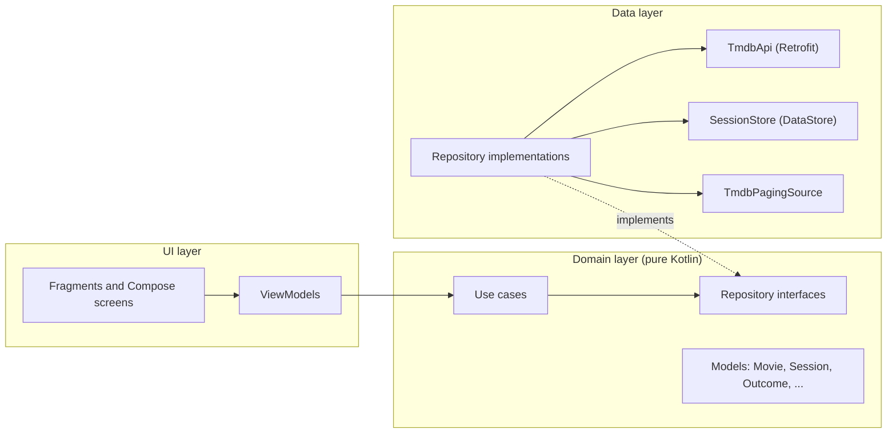
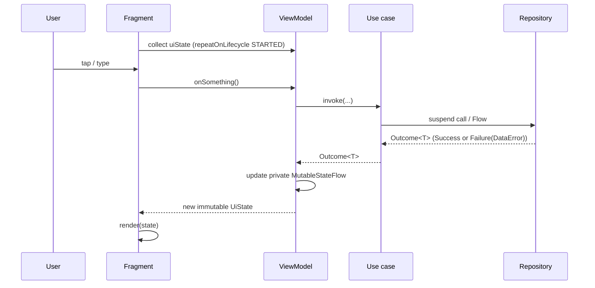
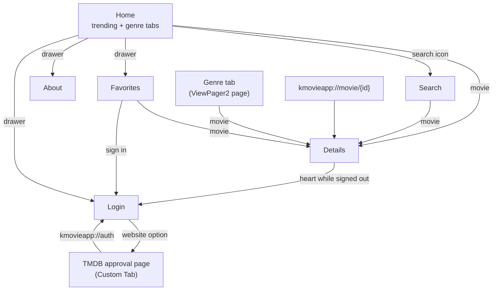
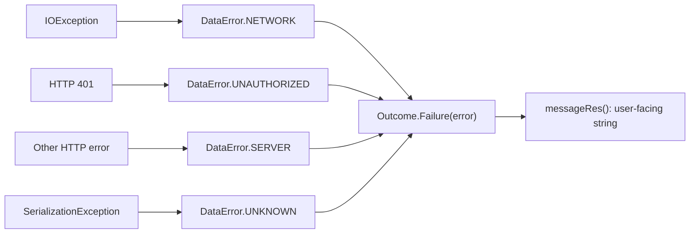
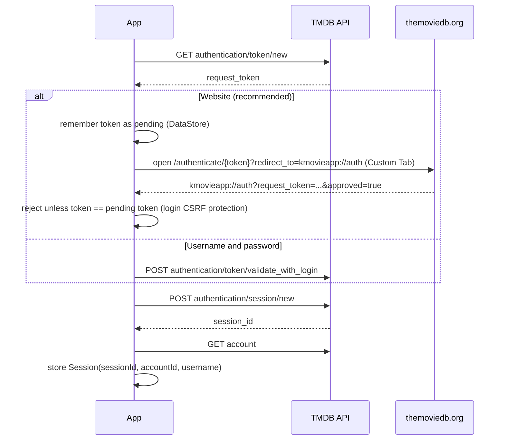

# KMovieApp Architecture

KMovieApp is an Android client for [TMDB](https://www.themoviedb.org). It shows trending movies, browses
by genre, searches the catalog, shows movie details with cast and trailers, and syncs favorites with the
user's TMDB account.

This document explains how the app is structured and why. It covers the layers, how data flows through
a screen, the sign-in flows, error handling, security decisions, and the trade-offs that were made on
purpose.

## Contents

- [Tech stack](#tech-stack)
- [Layers](#layers)
- [Package structure](#package-structure)
- [How a screen works](#how-a-screen-works)
- [Screens and navigation](#screens-and-navigation)
- [Paging](#paging)
- [Error handling](#error-handling)
- [Authentication](#authentication)
- [UI: XML with incremental Compose](#ui-xml-with-incremental-compose)
- [Dependency injection](#dependency-injection)
- [Security](#security)
- [Build variants and debug tooling](#build-variants-and-debug-tooling)
- [Testing](#testing)
- [Design decisions and trade-offs](#design-decisions-and-trade-offs)
- [Known limitations and next steps](#known-limitations-and-next-steps)

## Tech stack

| Area | Choice |
|---|---|
| Language | Kotlin 2.2, coroutines and Flow |
| UI | XML views with ViewBinding; Jetpack Compose (Material 3) for the login screen |
| Architecture | Clean Architecture (data / domain / ui), MVVM with unidirectional data flow |
| DI | Hilt (KSP) |
| Networking | Retrofit 3, OkHttp 5, kotlinx.serialization |
| Paging | Paging 3 |
| Navigation | Navigation component with Safe Args and deep links |
| Images | Coil 3 |
| Storage | DataStore (session), SharedPreferences (theme) |
| Debug tooling | Chucker, OkHttp Profiler (debug builds only) |
| Testing | JUnit 4, MockK, Turbine, kotlinx-coroutines-test, Paging testing, MockWebServer |
| Build | Gradle Kotlin DSL, version catalog, R8 with resource shrinking |
| Quality | GitHub Actions CI, ktlint (Android Studio style), detekt, Android lint |

## Layers

The app follows Clean Architecture with three layers. Dependencies point inward: the UI and data
layers depend on the domain layer, and the domain layer depends on neither.



| Layer | Responsibility | May depend on |
|---|---|---|
| **domain** | Business models, repository contracts, use cases. No Android framework, no Retrofit, no serialization. | Nothing (except `PagingData`, see [trade-offs](#design-decisions-and-trade-offs)) |
| **data** | Talks to TMDB and local storage. Maps DTOs to domain models and exceptions to `DataError`. | domain |
| **ui** | Renders state and forwards user actions. ViewModels hold presentation logic. | domain (never data) |

These rules hold throughout the codebase:

- **ViewModels depend only on use cases**, never on repositories, so every screen reaches data the same
  way.
- **The UI never imports the data layer.** It doesn't see DTOs, Retrofit, or DataStore.
- **DTOs never leave the data layer.** Mappers in `data/mapper` convert them to domain models, which also
  normalizes TMDB's quirks (blank dates and taglines become `null`, a runtime of `0` becomes `null`).

## Package structure

```
com.abeerapps.kmovieapp
├── KMovieApplication.kt          Hilt entry point; applies the saved theme before the first frame
├── domain
│   ├── model                     Movie, MovieDetails, Genre, CastMember, Trailer, Session,
│   │                             ThemeMode, Outcome / DataError / DataErrorException
│   ├── repository                MovieRepository, AuthRepository, FavoritesRepository,
│   │                             SettingsRepository (interfaces)
│   └── usecase                   One class per action, e.g. GetMovieDetailsUseCase,
│                                 SearchMoviesUseCase, SignInWithCredentialsUseCase
├── data
│   ├── remote                    TmdbApi, ApiKeyInterceptor, safeApiCall + error mapping
│   │   └── dto                   @Serializable request/response classes
│   ├── mapper                    DTO -> domain mappers, trailer selection
│   ├── paging                    TmdbPagingSource (shared by every paged list)
│   ├── local                     SessionStore (DataStore)
│   └── repository                Repository implementations
├── di                            NetworkModule, RepositoryModule, debug-tool declarations
└── ui
    ├── MainActivity.kt           Hosts navigation, the drawer, and the sign-in browser round trip
    ├── common                    BaseFragment, paging grid, error view, insets, navigation helpers
    ├── theme                     KMovieTheme (Compose), mapped from the XML color resources
    ├── drawer                    NavigationDrawerController
    ├── home / genre / search / details / favorites / login / about
    ├── auth                      SignInViewModel (activity-scoped), sign-out confirmation
    ├── settings                  SettingsViewModel (theme)
    └── debug                     NetworkInspector contract (implemented only in debug builds)
```

The `debug` source set (`app/src/debug`) contains the Chucker and OkHttp Profiler wiring. It isn't
compiled into release builds at all.

## How a screen works

Every screen follows the same unidirectional data flow:



- **State:** each ViewModel exposes one read-only `StateFlow<UiState>`. The state is an immutable data
  class or a sealed interface, for example `MovieDetailsUiState.Loading / Content / Error`.
- **One-off events** such as "ask the user to sign in" or "show a snackbar" go through a `Channel`
  exposed as a `Flow`, so they're delivered once and never replayed after rotation.
- **Lifecycle-safe collection:** `collectWithViewLifecycle` collects only while the fragment's *view*
  is at least STARTED. It stops in the background and never duplicates collectors when the view is
  recreated.
- **Process death:** navigation arguments (the movie id) and the search query live in `SavedStateHandle`,
  so they survive the process being killed. The login password deliberately does not; see
  [Security](#security).

### Fragment structure

All XML screens extend `BaseFragment<VB : ViewBinding>`, which owns the binding for exactly the view's
lifetime and clears it in `onDestroyView`, so views don't leak while a fragment is on the back stack.
`onViewCreated` reads like a table of contents:

```kotlin
override fun onViewCreated(view: View, savedInstanceState: Bundle?) {
    super.onViewCreated(view, savedInstanceState)
    applyInsets()
    binding.castList.adapter = castAdapter
    setUpClickListeners()
    observeViewModel()          // collects state into render(state)
}
```

Shared, non-universal helpers (flow collection, insets, paging grid, error view, navigation) are
extension functions rather than base-class methods, so `BaseFragment` doesn't grow into a catch-all.

### Example: movie details

`GetMovieDetailsUseCase` loads details, cast, and trailer **in parallel** with `async`. Cast and trailer
are optional: if either fails the screen still shows the details. If the details request fails, the
other two requests are cancelled.

The favorite button is updated **optimistically**: the heart changes immediately, and the change is
rolled back with a message if TMDB rejects it. If the user taps the heart while signed out, they're
sent to the login screen, and the movie is favorited automatically once they're signed in.

## Screens and navigation



- **Single activity:** `MainActivity` hosts a `NavHostFragment`. Movie details and login are global
  actions, so any screen can open them.
- **Typed arguments:** Safe Args passes the movie id, and `MovieDetailsViewModel` reads it from
  `SavedStateHandle`.
- **Double-tap safety:** `navigateSafely` and `navigateToMovieDetails` ignore repeated taps, so a quick
  second tap can't crash with an invalid navigation action.
- **Drawer:** owned by `NavigationDrawerController` (header with account state, Favorites, Theme, About,
  Sign out, version). It's only available on Home and locked elsewhere, and Back closes it first.

## Paging

Genre lists, search results, and favorites all use one `TmdbPagingSource`, which takes a
`suspend (page) -> MoviesPageDto` function. It:

- stops at TMDB's 500-page limit;
- removes movies TMDB repeats within a page, which would otherwise break `DiffUtil`;
- turns failures into `LoadResult.Error(DataErrorException(...))`, so the UI shows the same messages
  as everywhere else.

`setUpPagedMovieGrid` adds a full-width loading / retry footer. `toPagedListState` decides what to
show while the list is empty: a full-screen spinner, an empty message, or an error. When the list already
has items, `showRefreshErrors` reports a failed refresh with a snackbar instead of failing silently.

Search is debounced (400 ms), ignores queries shorter than 2 characters, and clears results immediately
when the field is cleared.

## Error handling

Failures never reach the UI as raw exceptions:



- `safeApiCall` wraps every request and rethrows `CancellationException`, so coroutine cancellation is
  never swallowed. Unexpected exceptions are rethrown too, so real bugs still crash and get noticed.
- Repositories return `Outcome<T>`; Paging receives a `DataErrorException` that carries the same
  `DataError`.
- The UI maps a `DataError` to a string resource in one place (`ErrorMessages.kt`). Context-specific
  wording overrides it where the meaning differs: during sign-in, a 401 means "Wrong username or
  password", not "session expired".
- A 401 on a favorites call clears the stored session, which signs the user out everywhere.

## Authentication

TMDB issues a `session_id` after a **request token** is approved. The app supports two ways to approve
it. Both end in the same `createSession` call and the same storage.



- **Session state:** `AuthRepository.session` is a `Flow<Session?>`. Screens react to it: Favorites
  switches to its signed-in state, the drawer shows the username, and the login screen closes itself
  once a session exists, whichever method was used.
- **Sign-up:** TMDB has no sign-up API, so "Create an account" opens TMDB's sign-up page in a Custom
  Tab.
- **Sign-out** deletes the session on TMDB when it can, and always clears it locally.

## UI: XML with incremental Compose

The app is XML-based, and **Compose is adopted one screen at a time**. The login screen is the first:

- `LoginFragment` extends `BaseFragment` like every other screen; its layout is a single `ComposeView`.
- `LoginScreen` is stateless (state in, callbacks out), with light and dark previews.
- `KMovieTheme` builds the Material 3 color scheme from **the same color resources** as the XML theme,
  plus the Poppins font. Brand colors and the Light / Dark / System setting stay in sync without
  duplicating values.

**Theming:** a `DayNight` Material 3 theme. Neutral colors flip through `values-night/colors.xml`, while
text and icons drawn on the yellow brand color (`on_brand`) stay dark in both modes. The user's theme
choice is saved and applied in `Application.onCreate`, before the first frame, so there's no flash of
the wrong theme.

**Edge-to-edge:** `enableEdgeToEdge()` plus small inset helpers (`applySystemBarsPadding`,
`applyStatusBarMargin`). The details poster draws behind the status bar while its buttons stay clear, and
lists pad for the navigation bar (and the keyboard, on Search).

## Dependency injection

Hilt modules:

| Module | Provides |
|---|---|
| `NetworkModule` | `Json`, `OkHttpClient` (timeouts, API key, debug interceptors), `Retrofit`, `TmdbApi` |
| `RepositoryModule` | `@Binds` from each repository interface to its implementation (singletons) |
| `DebugToolsModule` | `@BindsOptionalOf NetworkInspector` (only bound in debug builds) |
| `DebugNetworkModule` (debug source set) | Chucker and OkHttp Profiler interceptors, `NetworkInspector` |

Debug-only interceptors are contributed to a `@DebugInterceptor Set<Interceptor>` via multibinding. The
set is declared empty in `main`, so `NetworkModule` never changes when a tool is added or removed, and
release builds contain no debug libraries.

## Security

| Concern | Measure |
|---|---|
| Login CSRF via the sign-in deep link | Only the request token this app issued is accepted, once. Covered by unit tests. |
| Session token in backups | The session file is excluded from cloud backup and device transfer (`data_extraction_rules.xml`, `backup_rules.xml`). |
| Cleartext traffic | `network_security_config.xml` forces HTTPS on all API levels; debug builds also trust user CAs for proxy inspection. |
| Password handling | Kept in ViewModel memory only (never in `SavedStateHandle`), cleared on success, masked in the DTO's `toString()`, excluded from Chucker and OkHttp Profiler. |
| Logging | Timber is planted only in debug builds; network inspectors exist only in the debug source set. |
| API-provided URLs | The trailer key is URL-encoded before it's opened. |
| Release build | R8 minification and resource shrinking; not debuggable; the only exported app component is `MainActivity`. |
| API key | Read from `local.properties` into `BuildConfig`, so it isn't committed. |

## Build variants and debug tooling

| | debug | release |
|---|---|---|
| Application id | `com.abeerapps.kmovieapp.debug` | `com.abeerapps.kmovieapp` |
| Launcher label | "KMovieApp Debug" | "KMovieApp" |
| Chucker / OkHttp Profiler | Yes (password call excluded) | Not included |
| "Network inspector" in drawer | Yes | Hidden |
| Minify / shrink resources | No | Yes |

Setup: add `TMDB_API_KEY=<your v3 key>` to `local.properties`. It can also come from an environment
variable of the same name, for CI.

The project targets AGP 8.7.3 to stay compatible with the Android Studio version in use, and runs the
newer lint engine from AGP 8.13.2 (`android.experimental.lint.version`) because the bundled one can't
analyze Kotlin 2.2 or Compose code.

## Testing

Unit tests run on the JVM (`./gradlew testDebugUnitTest`):

| Area | What's covered |
|---|---|
| `TmdbApiTest` | The real Retrofit + OkHttp + serialization stack against MockWebServer: parsing a real TMDB response (nulls, blank dates, unknown fields), the API key on every request, request bodies, and HTTP/network failures mapped to `DataError` |
| `TmdbPagingSourceTest` | Page keys, the last page, the 500-page cap, de-duplication, error mapping |
| `MovieMappersTest` | Trailer selection rules, normalizing blank and zero values |
| `AuthRepositoryImplTest` | Website flow, credentials flow, and login-CSRF rejection |
| `GetMovieDetailsUseCaseTest` | Parallel loading; optional cast and trailer |
| ViewModel tests | Home, Details (optimistic favorite, sign-in then favorite), Sign-in events, Login (validation, trimming, errors, double submit) |

Test helpers: `MainDispatcherRule` (sets `Dispatchers.Main`) and builders in `testing/TestData.kt`.

### Continuous integration

[`.github/workflows/ci.yml`](.github/workflows/ci.yml) runs on every push and on pull requests to
`master`:

1. Validates the Gradle wrapper (protection against a tampered `gradle-wrapper.jar`).
2. `ktlintCheck detekt`: code style (rules in [`.editorconfig`](.editorconfig)) and static analysis
   (overrides in [`config/detekt/detekt.yml`](config/detekt/detekt.yml)).
3. `testDebugUnitTest`, then `lintDebug`.
4. `assembleDebug assembleRelease`, so R8 problems surface in CI rather than on a device.

Reports are uploaded when a step fails, and the debug APK is uploaded on every run. No secrets are
required: the app builds without a TMDB key, and tests use fake data.

detekt 1.23 is built with Kotlin 2.0, so the build resolves detekt's own Kotlin dependencies to 2.0.21
while the app compiles with Kotlin 2.2.

## Design decisions and trade-offs

- **`PagingData` in the domain layer.** It's a small library dependency in an otherwise pure layer,
  accepted because the alternative is reimplementing paging by hand.
- **Use cases even when they only delegate.** This keeps one consistent rule (ViewModels talk only to
  use cases) at the cost of a few one-line classes. `GetMovieDetailsUseCase` shows where a use case earns
  its place.
- **A Compose screen hosted in a Fragment** rather than a full migration. It shows incremental adoption
  without rewriting the app.
- **A favorites change counter instead of a cache.** `FavoritesRepositoryImpl` re-creates the favorites
  pager after each change, so lists stay correct without a local database.
- **SharedPreferences for the theme.** It has to be read synchronously at startup, before the first
  frame. Everything else uses DataStore.
- **`SessionStore` has no interface.** It's internal to the data layer, and tests replace it with MockK.

## Known limitations and next steps

- **Custom-scheme redirect:** another app could register `kmovieapp://auth` and try to intercept the
  approval redirect. Verified Android App Links would close this, but they require a domain the app
  controls. The username/password flow avoids the redirect entirely.
- **The API key ships in the APK**, as in any client that calls TMDB directly. A backend proxy is the
  only real fix.
- **No offline cache:** a Room database would let lists work offline.
- **No instrumented UI tests yet:** Compose UI tests for `LoginScreen` and Espresso tests for the main
  flows are next.
- **A single module.** Splitting into `:core:*` and `:feature:*` modules with convention plugins would
  pay off as the app grows.
