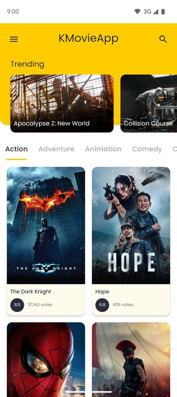
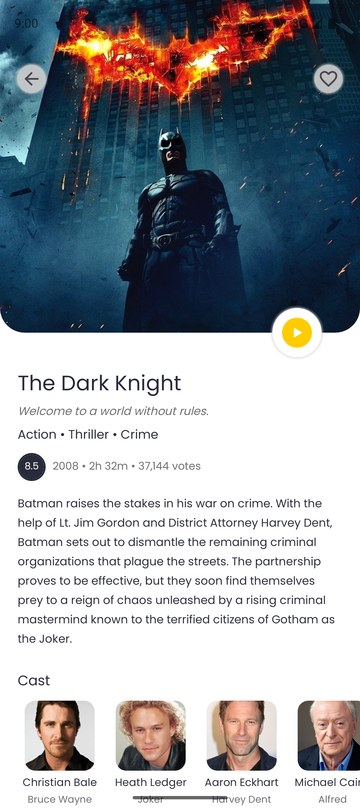
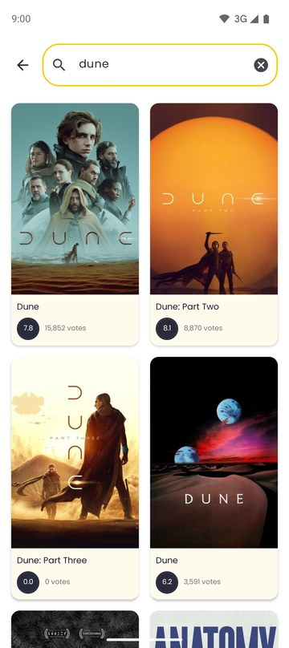
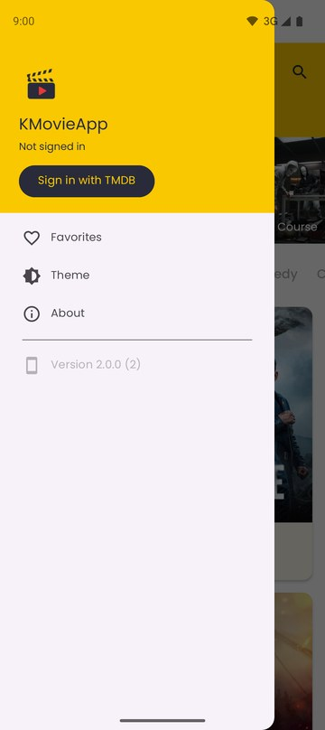
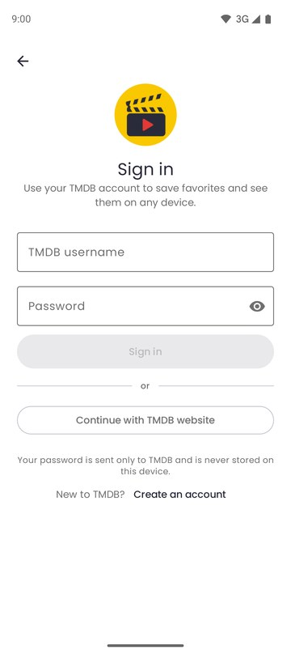
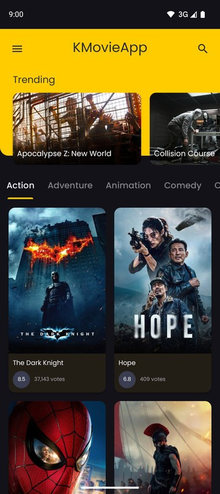
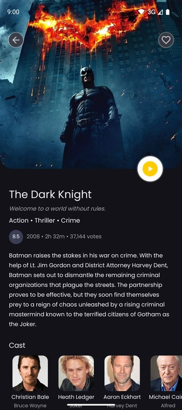
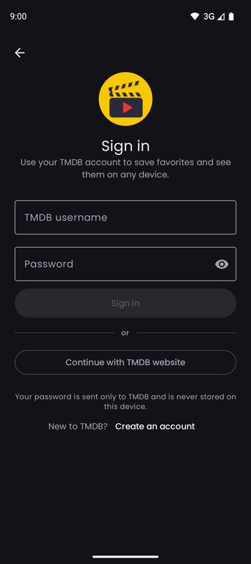
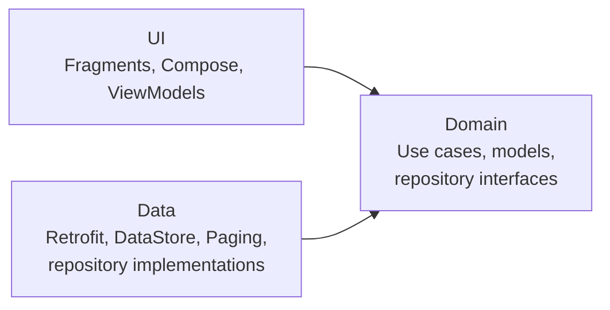

# KMovieApp

An Android app for discovering movies, built on [TMDB](https://www.themoviedb.org). Browse what's
trending, explore genres, search the full catalog, and keep favorites in sync with your TMDB account.


## Screenshots

| Home | Movie details | Search | Navigation drawer |
|:---:|:---:|:---:|:---:|
|  |  |  |  |

| Sign in (Compose) | Home, dark | Details, dark | Sign in, dark |
|:---:|:---:|:---:|:---:|
|  |  |  |  |

## Features

- **Trending and genres:** today's trending movies, plus a tab for every TMDB genre with endless
  scrolling and pull-to-refresh.
- **Search:** results update as you type, across the whole TMDB catalog.
- **Movie details:** poster, genres, runtime, rating, overview, cast with character names, and the
  official YouTube trailer when one exists.
- **Favorites:** saved to your TMDB account, so they follow you to other devices. The heart updates
  instantly.
- **Two ways to sign in:** with your TMDB username and password, or by approving access on
  themoviedb.org. New users can create a TMDB account from the app.
- **Light, dark, or system theme**, edge-to-edge on Android 15.
- **Deep links:** `kmovieapp://movie/{id}` opens a movie directly.
- **Handles the real world:** loading, empty, and error states with retry everywhere; survives rotation
  and process death; works on Android 7.0+.

## Tech stack

| | |
|---|---|
| **Language** | Kotlin, coroutines, Flow |
| **UI** | XML views with ViewBinding, Jetpack Compose (Material 3) for sign-in, Material Components |
| **Architecture** | Clean Architecture (data / domain / ui), MVVM, unidirectional data flow |
| **Dependency injection** | Hilt |
| **Networking** | Retrofit, OkHttp, kotlinx.serialization |
| **Data** | Paging 3, DataStore |
| **Navigation** | Navigation component, Safe Args, deep links |
| **Images** | Coil |
| **Testing** | JUnit, MockK, Turbine, coroutines-test, MockWebServer |
| **Tooling** | Gradle Kotlin DSL, version catalog, R8, Chucker and OkHttp Profiler (debug only) |

## Architecture

The app is split into three layers, with dependencies pointing inward:



- Each ViewModel exposes a single immutable UI state and talks to the domain layer only through use
  cases.
- The domain layer is plain Kotlin, independent of Android, networking, and storage.
- Network failures are mapped to typed errors (`NETWORK`, `SERVER`, `UNAUTHORIZED`, `UNKNOWN`), so the
  UI never handles raw exceptions.

**See [ARCHITECTURE.md](ARCHITECTURE.md)** for the full design: data flow through a screen, the sign-in
flows, paging, error handling, security decisions, and trade-offs.

## Getting started

### Requirements

- Android Studio Ladybug (2024.2) or newer
- JDK 17
- A free [TMDB API key](https://www.themoviedb.org/settings/api) (v3 "API Key")

### Setup

1. Clone the repository:
   ```bash
   git clone https://github.com/hiaryAbeer/KMovieApp.git
   ```
2. Add your TMDB key to `local.properties` in the project root. This file is ignored by git, so the
   key is never committed:
   ```properties
   TMDB_API_KEY=your_tmdb_v3_api_key
   ```
   The build also reads a `TMDB_API_KEY` environment variable, which is useful on CI.
3. Open the project in Android Studio and run the `app` configuration, or from the command line:
   ```bash
   ./gradlew installDebug
   ```

### Build variants

| | `debug` | `release` |
|---|---|---|
| Application id | `com.abeerapps.kmovieapp.debug` | `com.abeerapps.kmovieapp` |
| Launcher name | KMovieApp Debug | KMovieApp |
| Network inspectors | Chucker and OkHttp Profiler | Not included |
| Minified (R8) | No | Yes |

In debug builds, open the drawer and tap **Network inspector** to see every API call in Chucker. The
call that carries the password is never recorded.

## Testing

```bash
./gradlew testDebugUnitTest   # unit tests
./gradlew lintDebug           # Android lint
```

The tests cover ViewModels, use cases, mappers, and paging, plus the real Retrofit/OkHttp/serialization
stack run against MockWebServer with real TMDB responses. Security behavior is tested too, for example
that a forged sign-in redirect is rejected.

## Where to look

If you're reviewing the code, these parts show the main decisions:

| What | Where |
|---|---|
| Parallel loading with optional parts (details + cast + trailer) | [`GetMovieDetailsUseCase`](app/src/main/java/com/abeerapps/kmovieapp/domain/usecase/GetMovieDetailsUseCase.kt) |
| Typed error mapping without swallowing cancellation | [`SafeApiCall.kt`](app/src/main/java/com/abeerapps/kmovieapp/data/remote/SafeApiCall.kt) |
| Login CSRF protection on the sign-in redirect | [`AuthRepositoryImpl`](app/src/main/java/com/abeerapps/kmovieapp/data/repository/AuthRepositoryImpl.kt) |
| Optimistic favorite with rollback; favorite after sign-in | [`MovieDetailsViewModel`](app/src/main/java/com/abeerapps/kmovieapp/ui/details/MovieDetailsViewModel.kt) |
| One paging source for every paged list | [`TmdbPagingSource`](app/src/main/java/com/abeerapps/kmovieapp/data/paging/TmdbPagingSource.kt) |
| Compose screen inside the XML app, sharing one theme | [`LoginFragment`](app/src/main/java/com/abeerapps/kmovieapp/ui/login/LoginFragment.kt), [`KMovieTheme`](app/src/main/java/com/abeerapps/kmovieapp/ui/theme/KMovieTheme.kt) |
| View-binding lifecycle without leaks | [`BaseFragment`](app/src/main/java/com/abeerapps/kmovieapp/ui/common/BaseFragment.kt) |
| Debug tools that don't exist in release | [`app/src/debug`](app/src/debug/java/com/abeerapps/kmovieapp/di), [`DebugToolsModule`](app/src/main/java/com/abeerapps/kmovieapp/di/DebugToolsModule.kt) |

## Attribution

This product uses the TMDB API but is not endorsed or certified by TMDB. Movie data and images are
provided by [The Movie Database (TMDB)](https://www.themoviedb.org).
